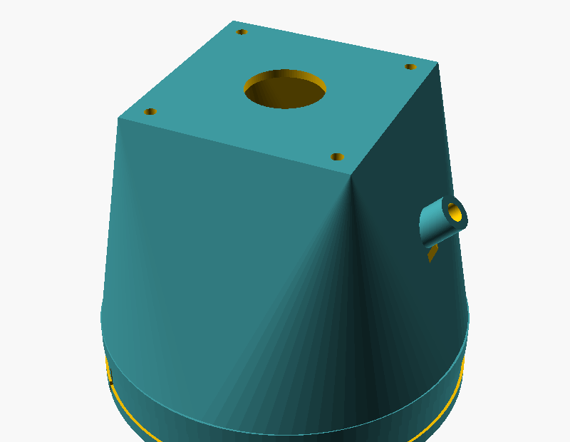
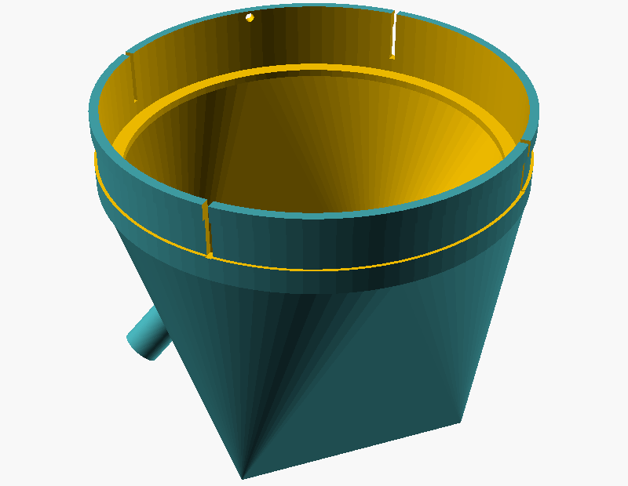

# NamJai Clip hardware

An ESP32-CAM in a weatherproof box, looking at the village main meter through a printed hood with two side lights.
Firmware: [`../firmware`](../firmware). Wiring: [`wiring.svg`](wiring.svg). Hood: [`hood.scad`](hood.scad) → [`stl/`](stl).

 

## Parts

Prices are **not filled in on purpose**: check current prices from Thai sellers before quoting a total.
The project's target is about ฿500–600 per Clip; that is a goal, not a measured cost.

| # | Part | Qty | Notes | Price (THB) |
|---|---|---|---|---|
| 1 | ESP32-CAM AI-Thinker with OV2640 camera | 1 | 4 MB flash, PSRAM | check |
| 2 | ESP32-CAM-MB USB programmer base | 1 | only for flashing; one per installer | check |
| 3 | 5 V 2 A power adapter | 1 | a weak supply causes brownout reboots | check |
| 4 | 18650 UPS / charger module with 5 V output | 1 | keeps the Clip running in a power cut | check |
| 5 | 18650 Li-ion cell (protected) | 1 | buy from a trusted seller | check |
| 6 | IP65 junction box, manufacturer-rated, with clear lid or window | 1 | the rating comes from the maker, not from us | check |
| 7 | White 5 mm LED | 2 | | check |
| 8 | AO3400 logic-level N-MOSFET (or similar) | 2 | LED switches | check |
| 9 | Resistors: 100 Ω ×4, 100 kΩ ×1, 10 kΩ ×1 | – | 10 kΩ on GPIO 12 is required | check |
| 10 | Silica gel sachets | 2 | replace at each visit | check |
| 11 | Hose clamp, sized to the meter | 1 | holds the hood collar | check |
| 12 | 1 mm translucent plastic sheet | small | LED diffusers (a milk-bottle piece works) | check |
| 13 | Anti-fog spray or wipe for the meter glass | – | | check |
| 14 | PETG or ASA filament | ~60 g | hood | check |
| 15 | Cable gland, wires, heat-shrink, M3 screws | – | | check |

## Print the hood

1. Measure the outside diameter of the meter top where the hood will sit. Set `meter_d` in `hood.scad`.
2. Print `test_ring` first (8 mm tall, a few minutes) and check the fit on the real meter.
3. Render: `openscad -o hood.stl hood.scad` (or `-D 'part="test_ring"'`). `stl/` has the 105 mm version.
4. PETG or ASA (sunlight), 3 walls, 25 % infill, plate side down. The LED bosses may need small supports.
5. `hood_h` (lens-to-glass distance) depends on the camera focus: check a sharp image before printing the final hood.

## Assemble and install

1. Wire as in `wiring.svg`. Keep the on-board flash LED unused (the firmware holds GPIO 4 low).
2. Flash the firmware (`firmware/README.md`), power it, set Wi-Fi, server URL and device token from a phone.
3. Push the LEDs into the bosses from outside, slide a diffuser strip into each slot.
4. Screw the hood plate to the enclosure lid over the lens window; seal the gap.
5. Wipe the meter glass, apply anti-fog, put a silica gel sachet in the box.
6. Fit the collar over the meter, tighten the hose clamp in the groove. The drain hole goes at the lowest point.
7. In the web app (caretaker), check the first photo, draw the digit box once and confirm the first reading.

## Tests to run before quoting numbers

| What | How | Pass |
|---|---|---|
| Reading accuracy | 50+ real photos per condition (clear, dust, fog, night) labelled in `ocr/data/real/` | report from `ocr/evaluate.py`, real-photo table only |
| Glare | photos with LED A, LED B, both, at several times of day | at least one of A/B clean in every case |
| Focus | photo at the chosen `hood_h` | all digits sharp (quality gate passes) |
| Offline capacity | measure real JPEG size; capacity ≈ 2.4 MB ÷ (2 × size) | write the measured number |
| Battery runtime | unplug mains with a full cell, log heartbeats | hours until the last heartbeat |
| Power-cut recovery | cut and restore power 10 times | boots, keeps queued photos |
| Watchdog | unplug the camera ribbon while running | reboots, reports `camera_failed` |
| Moisture | a week on site; check for fog inside the hood | readable photos all week |
| Flow from the dial needle (optional) | video of the needle vs a bucket and stopwatch | only claim it if it matches |

## Honest limits

- The printed hood is not waterproof and is not IP-rated. Only the bought enclosure carries a rating.
- One Clip watches one meter. It finds that a leak exists and roughly when it started; the soi comes from the night test.
- Real accuracy is unknown until the tests above are done.
